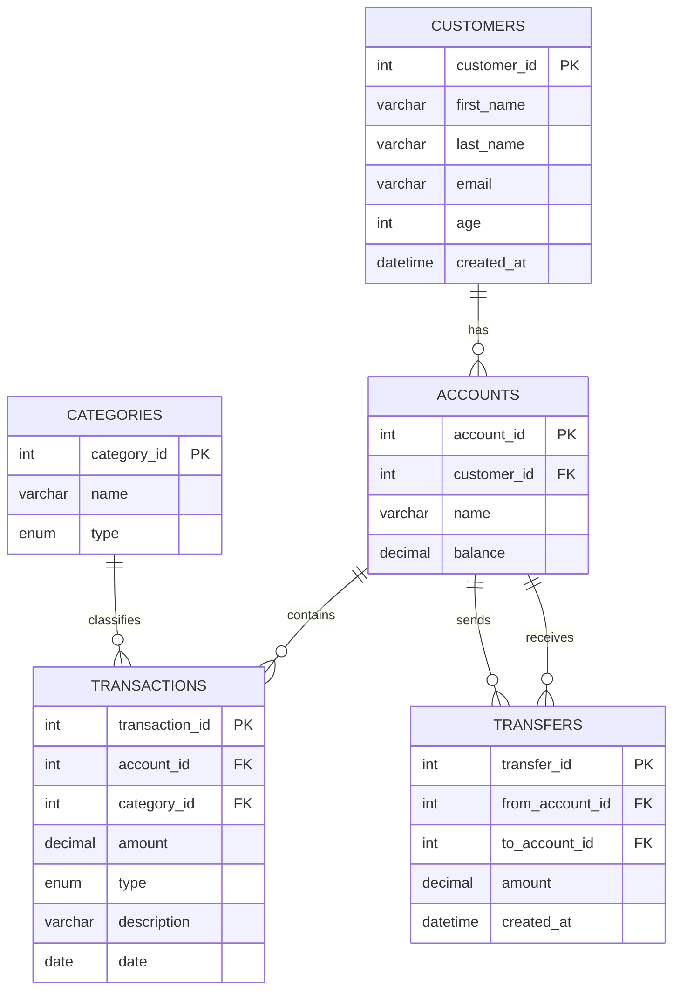

# 💰 Personal Finance Tracker

A MySQL project focused on personal finance management.  
Built to strengthen SQL skills through real-world schema design, 
queries, stored procedures, and data analysis.

## 🎯 Goals
- Design a normalized database schema
- Practice complex SQL queries (JOINs, CTEs, Window Functions)
- Write reusable stored procedures
- Optimize queries with indexes and views

## 🛠️ Tech Stack
- MySQL

## 🚀 How to Run

### Prerequisites
- MySQL 8.0+
- MySQL Workbench or any MySQL client

### Steps
1. Clone the repository
```bash
git clone https://github.com/cbarda/personal-finance-tracker.git
cd personal-finance-tracker
```

2. Create the database and tables
```bash
mysql -u root -p < schema/01_create_tables.sql
```

3. Load sample data
```bash
mysql -u root -p finance_tracker < data/sample_data.sql
```

4. Apply indexes, views and triggers
```bash
mysql -u root -p finance_tracker < schema/02_indexes.sql
mysql -u root -p finance_tracker < schema/03_views.sql
mysql -u root -p finance_tracker < schema/04_triggers.sql
```

5. Load stored procedures
```bash
mysql -u root -p finance_tracker < procedures/01_get_customer_transactions.sql
mysql -u root -p finance_tracker < procedures/02_get_customer_balance.sql
mysql -u root -p finance_tracker < procedures/03_monthly_spent.sql
mysql -u root -p finance_tracker < procedures/04_transfer_fund.sql
```

6. Run any query from the `queries/` folder!

## 📊 ER Diagram



## 📂 Structure

### schema/
| File | Description |
|------|-------------|
| `01_create_tables.sql` | Table definitions with constraints and foreign keys |
| `02_indexes.sql` | Indexes for query performance optimization |
| `03_views.sql` | Reusable views for common queries |
| `04_triggers.sql` | Trigger to auto-update account balance on transaction insert |

### data/
| File | Description |
|------|-------------|
| `sample_data.sql` | Sample data for testing |

### queries/
| File | Description |
|------|-------------|
| `01_joins_and_aggregations.sql` | JOINs, GROUP BY, HAVING |
| `02_common_table_expressions.sql` | CTEs and chained CTEs |
| `03_window_functions.sql` | SUM OVER, ROW_NUMBER, LAG, LEAD |

### procedures/
| File | Description |
|------|-------------|
| `01_get_customer_transactions.sql` | Get all transactions for a customer |
| `02_get_customer_balance.sql` | Get income, expenses and balance |
| `03_monthly_spent.sql` | Get total expenses per month |
| `04_transfer_fund.sql` | Implements transactional fund transfers with input validation, row locking, rollback handling and audit logging |

### docs/
| File | Description |
|------|-------------|
| `er_diagram.md` | Entity Relationship Diagram |

## 🔍 Sample Queries & Results

### 1. Customer Balance Summary
```sql
SELECT * FROM customer_balance_view;
```
| first_name | total_income | total_expenses | balance |
|------------|-------------|----------------|---------|
| Maria      | 1500.00     | 750.00         | 750.00  |
| Nikos      | 2500.00     | 900.00         | 1600.00 |
| Elena      | 800.00      | 50.00          | 750.00  |

---

### 2. Monthly Transactions
```sql
SELECT * FROM monthly_transactions_view;
```
| year | month | total_income | total_expenses | total_transactions |
|------|-------|-------------|----------------|-------------------|
| 2024 | 1     | 4800.00     | 1700.00        | 7                 |

---

### 3. Highest Transaction per Customer
```sql
WITH ranked AS (
    SELECT 
        cust.first_name,
        tra.description,
        tra.amount,
        ROW_NUMBER() OVER (PARTITION BY cust.customer_id ORDER BY tra.amount DESC) AS rank_by_amount
    FROM transactions tra
    JOIN accounts acc ON tra.account_id = acc.account_id
    JOIN customers cust ON acc.customer_id = cust.customer_id
)
SELECT * FROM ranked WHERE rank_by_amount = 1;
```
| first_name | description       | amount  | rank_by_amount |
|------------|------------------|---------|----------------|
| Maria      | Monthly salary    | 1500.00 | 1              |
| Nikos      | Monthly salary    | 2500.00 | 1              |
| Elena      | Freelance project | 800.00  | 1              |

## ⚙️ Stored Procedures

### get_customer_transactions
Returns all transactions for a specific customer, ordered by date descending.
```sql
CALL get_customer_transactions(1);
```

### get_customer_balance
Returns total income, expenses and calculated balance for a specific customer.
```sql
CALL get_customer_balance(1);
```

### monthly_spent
Returns total expenses for a specific customer for a given month and year.
```sql
CALL monthly_spent(1, 1, 2024); -- customer_id, month, year
```

### transfer_fund
Implements transactional fund transfers with input validation, row locking, rollback handling and audit logging.
- ✅ Validates amount (non-null, positive)
- ✅ Validates account IDs (non-null, different accounts)
- ✅ Locks both accounts in consistent order to prevent deadlocks
- ✅ Checks source account balance after lock to prevent race conditions
- ✅ Rolls back automatically on any failure
- ✅ Logs every transfer in the `transfers` table for audit trail
- ✅ Schema-level CHECK constraint prevents negative balances
```sql
CALL transfer_fund(1, 2, 100.00); -- from_account, to_account, amount
```

## 📚 Concepts Covered
- Schema design & normalization
- JOINs (INNER, LEFT, multiple tables)
- Aggregations (SUM, GROUP BY, HAVING)
- CTEs & chained CTEs
- Window Functions (SUM OVER, ROW_NUMBER, LAG, LEAD)
- Stored Procedures with input validation
- Views for reusable queries
- Triggers for automatic balance updates
- Transactions, COMMIT and ROLLBACK
- Deadlock prevention with consistent lock ordering
- Race condition handling with SELECT FOR UPDATE
- Query optimization with EXPLAIN & indexes
- Data integrity with FOREIGN KEYs, ENUM & CHECK constraints
